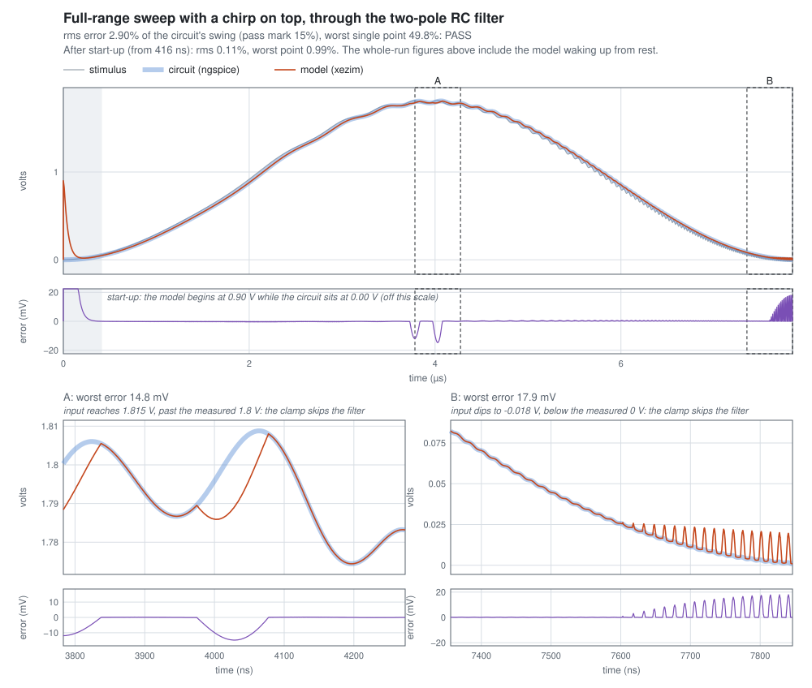

# Case study 1: two-pole filter

**Netlist** [`../../netlists/rc_lpf2.cir`](../../netlists/rc_lpf2.cir) ·
**Run it** `./demo_1_lpf.sh` ·
**Generated output** [`../../showcase/lpf2/`](../../showcase/lpf2/) ·
**Whitepaper** §3

An ordinary block: it takes a signal in and shapes its frequency response on
the way out. This is the baseline case, and it is here to establish that the
simple thing works before the awkward blocks arrive.

## The whole input

```spice
2-pole passive RC low-pass filter -- fast-running RNM test case
VIN vin 0 DC 0.9 AC 1
R1  vin  mid  1k
C1  mid  0    15.9p
R2  mid  vout 1k
C2  vout 0    15.9p
.end
```

That is everything the tool is given. No directives naming the ports, no hint
about what the block is for, no declared corner frequency.

## Results

| | |
|---|---|
| Chirp (swept-tone) equivalence | 0.0007 against a 0.15 threshold, **pass** |
| PRBS (independent stimulus) | 0.0067 normalised, **pass** |
| UVM-MS, DC section | 49 checks, 0 failed |
| UVM-MS, AC section | 15 checks, 0 failed |
| worst magnitude | 0.0927 dB of a 0.25 dB tolerance |
| worst phase | 0.39° of a 4.00° tolerance |

A *chirp* is a single sine wave whose frequency slides steadily upward during
the run, so one transient run exercises the block at every frequency in the
band. A *PRBS* is a pseudo-random bit sequence: a square wave jumping between
two levels on a shift-register pattern, with sharp edges and energy spread
across the band. Neither resembles the other.

The two scores are different metrics, scored against different limits, so
0.0007 being smaller than 0.0067 does not mean the chirp agreement is ten
times better. Read each against its own limit.

## The model says what it found

The head of the generated
[`rc_lpf2_rnm.sv`](../../showcase/lpf2/rc_lpf2_rnm.sv), exactly as published:

```systemverilog
// SystemVerilog Real Number Model, auto-generated by spice2rnm.
// Fitted transfer function: H(s) = 1 * 1  / ((1+s/2.4023e+07) * (1+s/1.64656e+08))
// poles (Hz): [3823382.3097665044, 26205852.219306976]
// fit quality: rms_error_db=1.417e-08  max_error_db=5.81e-08

module rc_lpf2_rnm(input wreal in_val, output wreal out_val);
```

The poles were measured from the circuit. Nobody declared them. The file also
records how closely its fitted transfer function matches those measurements:
the `fit quality` line gives the rms and worst-case error in dB. So you can
judge the model's accuracy without running anything.

## The model also says where its results stop counting as evidence

Every model carries the input range it was measured over. If an input falls
outside that range, the model says so instead of quietly returning a value:

```systemverilog
localparam real DOMAIN_LO = 0.0;
localparam real DOMAIN_HI = 1.8;

a_input_domain: assert (in_val >= DOMAIN_LO - DOMAIN_EPS
                     && in_val <= DOMAIN_HI + DOMAIN_EPS)
else ... $warning("%m: input %0.6g V is outside the characterized
  range %0.6g..%0.6g V. static_curve clamps there, so this model
  keeps running and returns the endpoint value -- it is not
  extrapolating, and it is no longer evidence. Reported once.");
```

Asked for a voltage it was never measured at, the model neither fails nor
extrapolates. It clamps: it keeps handing back the value at the edge of its
range. That value looks perfectly plausible, which is what makes this case
dangerous and why the warning exists. The warning fires once per model, so
the log of a long run stays readable.

Remove the assertions with `+define+SPICE2RNM_NO_ASSERT`. They are silent on
every run in the showcase, which is the only way a check stays switched on.

## Why the PRBS row matters more than it looks

The model is built from a chirp. It is then tested with a pseudo-random bit
sequence it has never seen. A model that had only memorised the stimulus it
was built from would fall over here. This one does not.

That is the general principle in
[equivalence.md](../equivalence.md#what-keeps-a-figure-from-flattering-itself):
a fit marking its own homework is not evidence.

## The picture

The whitepaper plots two moments of the same chirp, at the simulator's own
time resolution: the stimulus in grey, the transistors in black, the
generated model in red dashed. Early in the sweep the output follows the
input. Late in the sweep the input still swings but the output barely moves,
which is the filter doing its job. Measured over 100 ns windows, the
output-to-input swing ratio is 0.99 in the first window and 0.50 in the
second, and the model tracks the transistors through both.

The data behind that plot is `waveform_compare.csv` and the PWL
(piecewise-linear) stimulus in the run's own `equivalence/` directory. The
aligned comparison is 18.6 MB, so it is listed in
[`MANIFEST.txt`](../../showcase/lpf2/equivalence/) with the command that
recreates it rather than committed. See
[equivalence.md](../equivalence.md#why-some-files-are-listed-instead-of-published).

## This circuit twice over

[`../../showcase/lpf2_house/`](../../showcase/lpf2_house/) is the same filter
generated against a hand-written model library instead of against the tool's
own conventions. The scoreboard is byte-identical between the two
directories, and the model files differ only in their port declarations
(`wreal` nets in one, `real` variables in the other), which leaves the score
identical to every digit; only the boundary changes. That is the subject of
[joining-a-model-library.md](../joining-a-model-library.md).

## Waveforms worth opening

Binary data first, because the model was never fitted to it. Each bit is a
step on the input; the filter is too slow to finish one step before the
next arrives, so the output wanders between the rails, carrying a memory of
the last few bits (inter-symbol interference). The thick blue line is the
circuit as ngspice solves it, the thin red line is the generated model, and
the strip underneath is their difference:


Both start where ngspice starts: the model opens settled at the stimulus's
first value, as ngspice's operating point does, so the two traces lie on
each other from the first nanosecond. The score is taken from 416 ns (ten
time constants), the window `prbs_sweep2.py` uses, and there the two agree
to 0.67% rms of the output swing. (Until spice2rnm #77 the model opened at
its 0.9 V bias and the first 416 ns had to be left out for that reason.)

The pipeline's own check is the slow sweep with a chirp on top, below:
0.07% rms and 0.56% at the worst point, over the whole run. The two boxed
stretches are where the model is furthest from the circuit, and both are
where the stimulus steps just outside the 0 to 1.8 V range the model was
measured over (it reaches −0.018 V and 1.815 V). There the model holds its
input at the edge of that range, the furthest it was measured, and filters
it like any other input, while the circuit keeps following the input: the
red line levels off smoothly a few millivolts short of the blue one. The
error in each box (10.1 mV in A, 5.3 mV in B) is the input's excess passed
through the filter, and it only happens outside the measured range. (Until
spice2rnm #76 that excess skipped the filter and landed on the output
instantly, as sharp corners and spikes no RC filter can make.)



To zoom in yourself with nothing installed, open
[the PRBS page](https://vrajeshprakhya.github.io/spice2rnm-demos/lpf2/lpf2_prbs.html)
or [the chirp page](https://vrajeshprakhya.github.io/spice2rnm-demos/lpf2/lpf2_chirp.html)
and drag across the plot. Each page holds every point the run wrote, has a
button for each box above, and reads out all four traces at whatever
instant you hover over. Hover inside box A and the readout shows the
stimulus above 1.8 V while the model holds at the edge. "Hide stimulus"
fits the axis to the circuit and the model alone, which shows how the
model moves: in steps about 0.3 ns apart, one per solver step. The pages
are also in [`../../showcase/lpf2/waveforms/`](../../showcase/lpf2/waveforms/)
to download and open offline.

In GTKWave, run demo 1 (or `python3 harness/wave_bundle.py lpf2` after
it), then:

```sh
cd ~/s2r_runs/lpf2_wave
gtkwave lpf2_prbs.fst lpf2_prbs.gtkw     # or lpf2_chirp.fst lpf2_chirp.gtkw
```

The `.gtkw` file opens with the four traces (`vin`, `vout_circuit`,
`vout_model`, `error`) already drawn as curves and the whole run in view,
so there is nothing to set up. The PRBS files are in the showcase folder;
the chirp's are on the
[Releases page](https://github.com/vrajeshprakhya/spice2rnm-demos/releases).
The folder's `README.txt` says how each score was taken.

For debugging rather than reading, the PRBS run also keeps a dump of every
signal inside the model, including its RK4 stages:
`gtkwave ~/s2r_runs/lpf2_vcd/tb_prbs.vcd`. Real numbers there show as
decimal text until you right-click each one → Data Format → Analog →
Interpolated.

## The verification run, drawn

Demo 1's sixth act runs the generated UVM-MS environment and prints its
scoreboard: 49 DC checks and 15 AC checks against ngspice, none failed.
[The UVM-MS page](https://vrajeshprakhya.github.io/spice2rnm-demos/lpf2/lpf2_uvm.html)
draws the run those verdicts came from. The input climbs a staircase of 41
levels, waiting at each until the output stops moving, then carries small
sines (3.6 mV on 0.9 V) at ten frequencies from 199.5 kHz to 50.1 MHz.
At every check the page marks what the model read and what ngspice says it
should have read, and hovering shows the scoreboard's own log line. It is
built by `python3 harness/uvm_wave.py lpf2`, which re-runs the environment
with three lines added to a copy of its top module to record the nets; the
AC gains it re-measures from that recording agree with the scoreboard's to
within 0.0002 dB.

The phase checks can be taken at face value. The bridge plays each sine as
a staircase, 64 steps per cycle, and reads the output at the middle of each
step, where the held value stands for the sine. Drive the ideal circuit
(the netlist's own resistors and capacitors, solved exactly) through the
same staircase, read it the same way, and set it beside ngspice and the
model:

| frequency | ngspice | ideal circuit, read by the bridge | model, read by the bridge |
|---|---|---|---|
| 199.5 kHz | −3.42° | −3.03° | −3.03° |
| 707.9 kHz | −12.04° | −12.00° | −12.00° |
| 7.94 MHz | −81.16° | −81.16° | −81.16° |
| 28.2 MHz | −129.36° | −129.34° | −129.33° |
| 50.1 MHz | −148.03° | −147.90° | −147.86° |

The model is within 0.04° of the ideal circuit at every checked frequency.
The scoreboard's worst phase error, 0.39° at 199.5 kHz, is the staircase
itself: the ideal circuit reads the same there, because at the bottom of
the band the circuit is fast enough to follow the individual steps. The
worst gain error, 0.0927 dB at 50.1 MHz, sits where the bridge's step
(0.31 ns) is almost the model's own (0.30 ns), so where in each model step
the reading lands drifts slowly. `python3 harness/uvm_phase_split.py`
reproduces the table from the recorded run.

This page is how two problems were found and fixed. When it was first
drawn, every phase check carried a 2.8° lead of the bridge's own (it read
at the end of each step), and the model trailed by one whole time step;
the two partly cancelled, so the scoreboard showed 2.68° at 50.1 MHz where
the model was 5.64° behind. spice2rnm #79 moved the read to the middle of
the step and #78 made the model publish its output for the right instant,
and the phase tolerance went from 8° to 4° (#82).

One residual is not explained yet. Shifting the PRBS model 0.3 to 0.45 ns
earlier still lowers its error (0.67% to 0.50% rms). The AC checks put the
model's own delay under 0.03 ns, so that offset sits in how the PRBS run is
driven or logged, not in the model; it has not been chased further.
